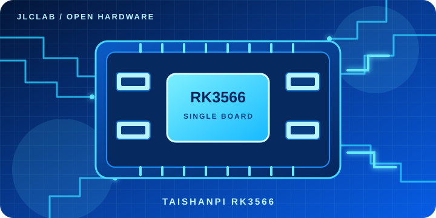
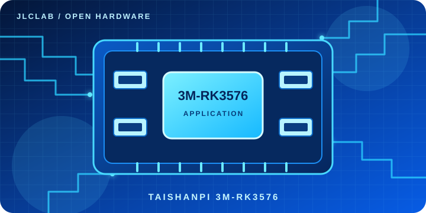
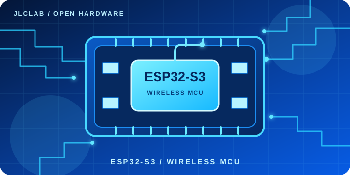
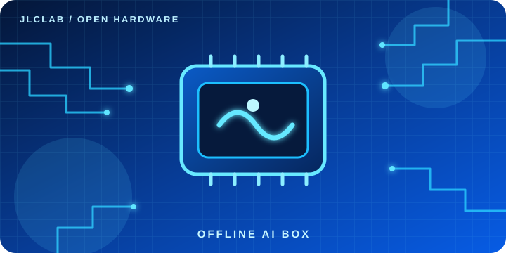
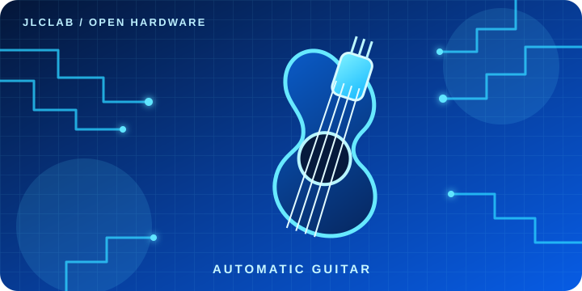
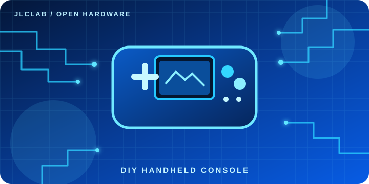
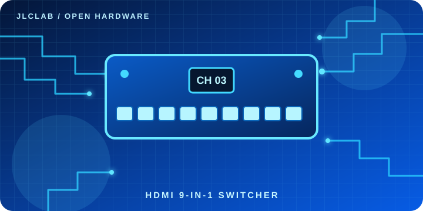
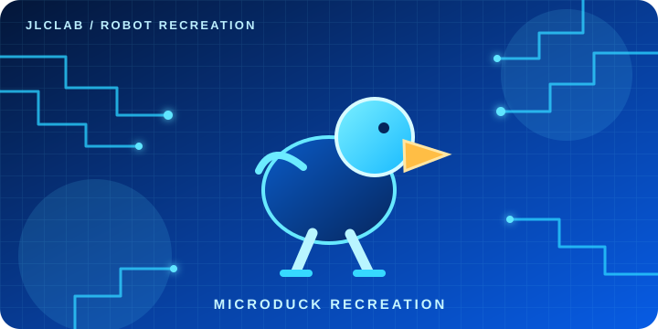
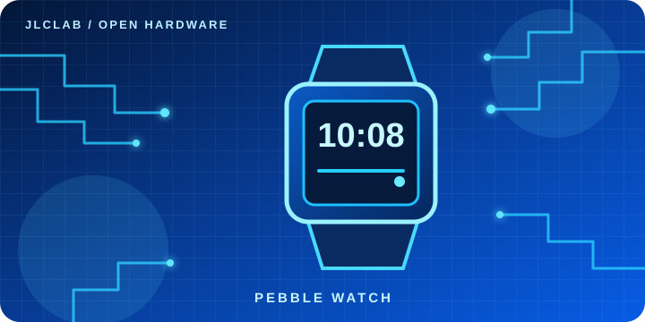

<!-- =====================================================
     JLCLAB | GitHub Organization Profile
     HTML-first | Compact | GitHub Compatible
     ===================================================== -->

<!-- ==================== HERO ==================== -->

  

<h2 align="center">Build. Share. Make It Real.</h2>

  Open hardware, practical projects, and development resources. 
  Built for engineers, makers, and people who love to build things.

  
  
  

<!-- ==================== FEATURED PRODUCTS ==================== -->

<h2 align="center">FEATURED PRODUCTS</h2>

  Development boards for embedded systems, Linux, and wireless applications.

<table width="100%" cellpadding="10" cellspacing="0">
<tr>

<td width="33.33%" align="center" valign="top">

<h3>TaishanPi RK3566</h3>

  An embedded Linux development board for DIY, multimedia, and practical hardware projects.

<a href="https://github.com/orgs/jlclab-io/repositories?q=RK3566">
  Explore RK3566 →
</a>

</td>

<td width="33.33%" align="center" valign="top">

<h3>TaishanPi RK3576</h3>

  A powerful Linux development platform for multimedia, edge AI, and embedded applications.

<a href="https://wiki.lckfb.com/en/tspi-3-rk3576">
  Explore RK3576 →
</a>

</td>

<td width="33.33%" align="center" valign="top">

<h3>ESP32-S3</h3>

  A wireless MCU platform for IoT, interactive devices, and embedded development.

<a href="https://github.com/orgs/jlclab-io/repositories?q=ESP32-S3">
  Explore ESP32-S3 →
</a>

</td>

</tr>
</table>

<!-- ==================== FEATURED PROJECTS ==================== -->

<h2 align="center">FEATURED OPEN-SOURCE PROJECTS</h2>

  Real hardware. Real experiments. Open-source builds.

<table width="100%" cellpadding="10" cellspacing="0">

<tr>

<td width="33.33%" align="center" valign="top">

<h3>Offline AI Box</h3>

  An offline AI assistant powered by lightweight language models.

<a href="https://github.com/orgs/jlclab-io/repositories?q=AI">
  Explore Project →
</a>

</td>

<td width="33.33%" align="center" valign="top">

<h3>Automatic Guitar</h3>

  An interactive guitar project with automatic accompaniment.

<a href="https://github.com/orgs/jlclab-io/repositories?q=guitar">
  Explore Project →
</a>

</td>

<td width="33.33%" align="center" valign="top">

<h3>DIY Handheld Console</h3>

  A portable DIY gaming console built with an embedded development board.

<a href="https://github.com/orgs/jlclab-io/repositories?q=handheld">
  Explore Project →
</a>

</td>

</tr>

<tr>

<td width="33.33%" align="center" valign="top">

<h3>HDMI 9-in-1 Switcher</h3>

  Nine HDMI inputs, one output, with OLED channel status display.

<a href="https://github.com/orgs/jlclab-io/repositories?q=HDMI">
  Explore Project →
</a>

</td>

<td width="33.33%" align="center" valign="top">

<h3>MicroDuck Robot Replica</h3>

  An open-source bipedal robot duck replica. Explore movement, balance, and self-recovery.

<a href="https://github.com/orgs/jlclab-io/repositories?q=MicroDuck">
  Explore Project →
</a>

</td>

<td width="33.33%" align="center" valign="top">

<h3>Pebble Watch Replica</h3>

  A DIY recreation of the Pebble smartwatch, featuring display and device interaction.

<a href="https://github.com/orgs/jlclab-io/repositories?q=Pebble">
  Explore Project →
</a>

</td>

</tr>
</table>

<!-- ==================== DEVELOPER RESOURCES ==================== -->

<h2 align="center">DEVELOPER RESOURCES</h2>

<table width="100%" cellpadding="10" cellspacing="0">
<tr>

<td width="33.33%" align="center" valign="middle">

<h3>GitHub</h3>

Source code, hardware designs, and open-source projects.

<a href="https://github.com/orgs/jlclab-io/repositories">
  Browse Repositories →
</a>

</td>

<td width="33.33%" align="center" valign="middle">

<h3>Documentation</h3>

Board documentation, tutorials, and development guides.

<a href="https://wiki.lckfb.com/en/tspi-3-rk3576">
  Read Documentation →
</a>

</td>

<td width="33.33%" align="center" valign="middle">

<h3>Community</h3>

Share projects, exchange ideas, and connect with makers.

<a href="https://www.reddit.com/r/JLCLab/">
  Join JLCLab →
</a>

</td>

</tr>
</table>

<!-- ==================== COMMUNITY ==================== -->

<h2 align="center">BUILD WITH US</h2>

  Have an idea? Built something interesting? 
  Share your projects and build with the JLCLAB community.

  
  

  <strong>OUR MISSION: JUST HELP ENGINEERS.</strong>
   
  Build · Experiment · Share

